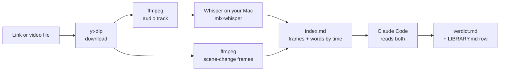

# VS Video Reader

**Let Claude watch trading videos for you, and tell you what's actually on the chart.**

Drop a YouTube or Facebook link (or a video you downloaded). VS Video Reader pulls out the spoken words *and* the chart
frames, lines them up by timestamp, and hands them to [Claude Code](https://claude.com/claude-code). You get back the
strategy written out rule by rule, its strong and weak points, and a verdict, saved in a tidy library on your Mac.

Speech-to-text runs **locally on your Mac's GPU**. No audio or video is uploaded anywhere.

---

## Why

Trading videos explain their logic *on the chart*: "this candle here", "we enter here", "stop goes just above". A
transcript alone loses all of that, and presenters often **say one number while the chart shows another**.

In one test, the presenter said *"750 ticks stop, 2 to 1"* while the position tool on screen read **stop 4.67, risk/reward
3.21**. Forty seconds later the replay showed stop 7.50, target 15.00, and the target was never hit. Only a reader
that sees the frames catches that. The full write-up is in [`examples/sample-verdict.md`](examples/sample-verdict.md).

## What it does

- 🎬 **Reads links and files**: YouTube, public Facebook videos and Reels, anything [yt-dlp](https://github.com/yt-dlp/yt-dlp) opens, or any video you drop in `inbox/`
- 🗣️ **Local Whisper**: `whisper-large-v3-turbo` on Apple Silicon via [MLX](https://github.com/ml-explore/mlx). About 5 s for 6 minutes of speech
- 🖼️ **Smart chart frames**: one frame on every scene change, plus at least one every 20 s, so a static chart with a talking presenter is still sampled
- 🔗 **Words matched to pictures**: each frame carries exactly what was said while it was on screen
- 🧠 **Structured verdict**: the strategy literally, chart-vs-speech gaps, strong points, video tricks, and a verdict per trading style (swing · intraday · scalping)
- 📚 **A library with memory**: `LIBRARY.md` logs every video. The same link, or the same file even renamed, is recognised and never processed twice
- 🧹 **Cleanup on your terms**: free space by date with a dry run first. Nothing is ever deleted automatically

## Example output

A real run on a public 5:49 YouTube video, on an M-series Mac: 62 transcript lines and 33 chart frames in about
30 seconds, of which local Whisper took 7.

| File | What it is |
|---|---|
| [`examples/sample-index.md`](examples/sample-index.md) | what Claude reads: each chart frame with the exact words spoken while it was on screen |
| [`examples/sample-verdict.md`](examples/sample-verdict.md) | what Claude writes back: the strategy rule by rule, chart-vs-speech gaps, strong points, what the video doesn't show, a verdict per trading style |

## How it works



Words come from the **creator's own subtitles** when a video has them, otherwise from **local Whisper**, otherwise
from YouTube's auto-captions.

## Quick start

**Needs:** a Mac with Apple Silicon (M1 or newer), [Homebrew](https://brew.sh), Python 3.9+, and
[Claude Code](https://claude.com/claude-code) for the verdict step.

```bash
git clone https://github.com/ChhuyVannithDev/vs-video-reader.git
cd vs-video-reader
./setup.sh
```

`setup.sh` installs `yt-dlp` and `ffmpeg`, creates `~/VS-Video-Read/`, installs mlx-whisper in its own Python
environment, downloads the model (~1.5 GB, one time) and copies the skill into `~/.claude/skills/`. It's safe to run
again.

## Use it

**In Claude Code**, just talk:

```text
read this video https://www.youtube.com/watch?v=...
read my inbox
read 12:00 to 25:00 of this video ...
delete last month's videos
```

**Or run the extractor yourself**:

```bash
python3 skill/vs-video-read/scripts/video_read.py "https://www.youtube.com/watch?v=..."
python3 skill/vs-video-read/scripts/video_read.py ~/Downloads/strategy.mp4 --from 60 --to 600
```

| Option | What it does |
|---|---|
| `--from 720 --to 1500` | read only that part (seconds) |
| `--language th` | force the spoken language (auto-detect by default) |
| `--transcript whisper\|yt\|none` | force where the words come from |
| `--every 20` · `--scene 0.12` · `--max-frames 60` | frame density |
| `--no-frames` | words only, for a quick look |
| `--keep-video` | keep a video downloaded from a link |
| `--force` | read again even if it's in the library |

## Your library

```text
~/VS-Video-Read/
├── LIBRARY.md                 every video read: date · title · source · one-line verdict
├── inbox/                     drop downloaded videos here
├── library/
│   └── 2026-10-20_<video-name>/
│       ├── verdict.md         the write-up
│       ├── transcript.txt     every word, with times
│       ├── index.md           frames + words, matched by time
│       ├── frames/            chart pictures
│       ├── audio.m4a          the speech track (small, mono)
│       └── meta.json          title, channel, chapters, description
└── _engine/                   local Whisper + model (don't touch)
```

Each link takes about 5–10 MB, mostly frames. A video downloaded from a link is deleted once its frames are taken;
your own files are kept.

## Freeing space

```bash
python3 skill/vs-video-read/scripts/cleanup.py --older-than 7        # dry run: shows what would go
python3 skill/vs-video-read/scripts/cleanup.py --older-than 7 --yes  # delete
```

Also `--before 2026-11-01` or `--month 2026-10`. By default it keeps each `verdict.md` and the text and removes frames,
audio and video. `--all-files` removes whole folders. `LIBRARY.md` always keeps the history (rows are marked 🗑️).

## Privacy and safety

- **Local speech-to-text.** Audio is processed on your Mac. Once the model is downloaded, Whisper loads it offline.
- **No logins, no cookies.** Private, members-only or friends-only videos are never fetched through your accounts.
  Download them yourself and drop them in `inbox/`.
- **No API keys.** Nothing in this repo needs one.
- **Study only.** It explains strategies; it never places trades.

## Platform support

| Platform | Status |
|---|---|
| macOS · Apple Silicon | ✅ Full (local Whisper) |
| macOS · Intel, Linux, Windows | ⚠️ Captions-only: install `yt-dlp` + `ffmpeg` yourself; videos without subtitles give frames only |

## Limits

- Facebook and YouTube public links are tested. X / TikTok usually work through yt-dlp, but aren't tested.
- Whisper is weak on some languages (e.g. Khmer). The chart frames still work.
- A video with no sound gives frames only.
- The verdict is an AI reading of a video, **not financial advice**. Backtest any idea on your own data before
  trading it.

## Built with

[yt-dlp](https://github.com/yt-dlp/yt-dlp) · [FFmpeg](https://ffmpeg.org) ·
[mlx-whisper](https://github.com/ml-explore/mlx-examples/tree/main/whisper) ·
[Whisper large-v3-turbo](https://huggingface.co/mlx-community/whisper-large-v3-turbo) ·
[Claude Code](https://claude.com/claude-code)

## About the author

Built by **Chhuy Vannith** (VSDev), a PHP and MQL5 developer in Cambodia who builds trading systems for gold. This tool
grew out of a daily habit: studying other traders' videos to pull out the one rule worth testing, without trusting the
words over the chart. It is published so anyone can do the same on their own Mac.

- Site: [vincentchhuy.com](https://vincentchhuy.com)
- GitHub: [@ChhuyVannithDev](https://github.com/ChhuyVannithDev)
- Issues and ideas: open one on this repo

Changes are listed in [CHANGELOG.md](CHANGELOG.md).

## License

[MIT](LICENSE) © Chhuy Vannith · [vincentchhuy.com](https://vincentchhuy.com)
